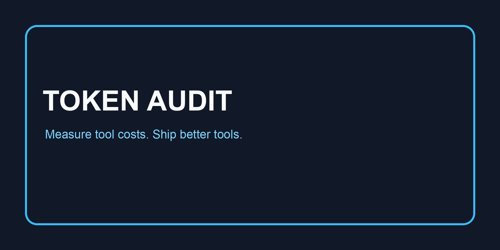

# Token Audit

Rank recent AgentD3 conversations by observed tool payload, repeated operations, and bounded-helper adoption. Use the evidence to select and ship one practical tool improvement; do not treat payload estimates as billed model usage.

## Use

Run the installed audit with a small recent sample:

```bash
~/.agents/skills/token-audit/scripts/audit-conversations.sh --skip "$AGENTD3_CONVERSATION_ID" --count 10
```

Inspect only ranked evidence references with `--conversation ID --inspect ID:EVENT_SEQ`. Read the skill instructions for audit interpretation, bounded helpers, safe source changes, and publication requirements.

## Installation

The skill is installed at `~/.agents/skills/token-audit`. The audit script and its tests are included in this repository.
